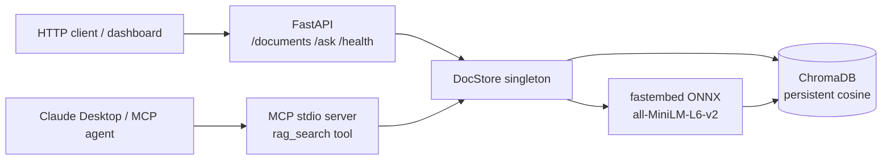
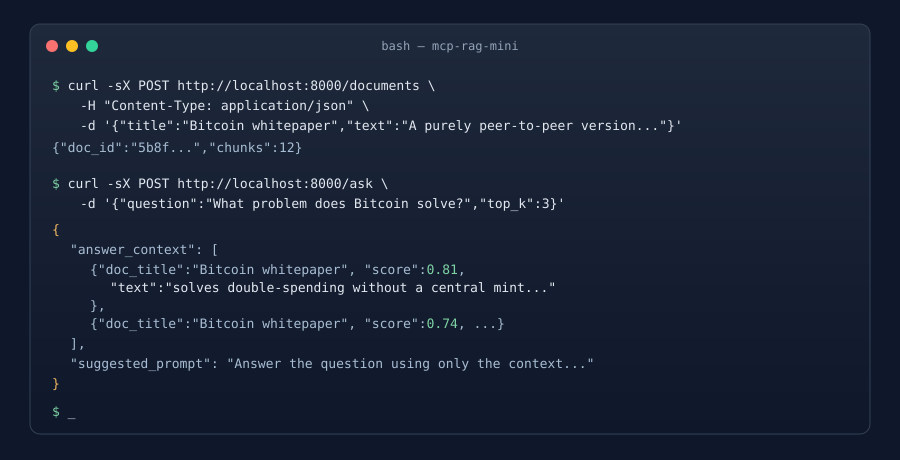

# mcp-rag-mini


[](https://github.com/Pinger1456/mcp-rag-mini/actions/workflows/ci.yml)

Minimal RAG service exposing the same vector index over **two interfaces**:

- **REST** (`FastAPI`) — upload docs, query for top-k relevant chunks, get a suggested LLM prompt.
- **MCP server** (`stdio`) — a `rag_search` tool that any MCP-compatible client (Claude Desktop, custom agents) can call directly.

Both interfaces share one `DocStore` — ChromaDB for vectors, `fastembed` (ONNX) for embeddings, cosine similarity. No LLM inside; the service is a clean retrieval layer.

## Architecture



Same `DocStore` under both entry points — no drift between what "an LLM sees" and "a dashboard sees".

## Demo



## Why this shape

Most RAG demos mix embedding, retrieval, and generation into one script. That's fine for a notebook, but production systems separate them — the retrieval layer needs its own SLOs (recall@k, latency), its own tests, and its own scaling story. Splitting it out means:

- **REST** works for classic HTTP-based agents / dashboards / eval harnesses.
- **MCP** works for LLM tool-use (Claude, Cursor, custom loops) with no glue code.
- **Same index, same guarantees** — no drift between what "an LLM sees" vs "a dashboard sees".

## Stack

- Python 3.12, FastAPI, Uvicorn
- ChromaDB (persistent) + `fastembed` (all-MiniLM-L6-v2, ONNX runtime — no torch)
- MCP Python SDK
- Docker + docker-compose

## Run locally

```bash
python -m venv .venv
.venv\Scripts\activate  # Windows
# source .venv/bin/activate  # macOS/Linux

pip install -r requirements.txt
uvicorn app.api:app --reload
```

Or via Docker:

```bash
docker compose up --build
```

## Try it

```bash
# Upload a document
curl -X POST http://localhost:8000/documents \
  -H "Content-Type: application/json" \
  -d '{"title":"Bitcoin whitepaper intro","text":"A purely peer-to-peer version of electronic cash..."}'

# Ask a question
curl -X POST http://localhost:8000/ask \
  -H "Content-Type: application/json" \
  -d '{"question":"What problem does Bitcoin solve?","top_k":3}'
```

## MCP integration (Claude Desktop)

Add to `claude_desktop_config.json`:

```json
{
  "mcpServers": {
    "rag-mini": {
      "command": "python",
      "args": ["-m", "app.mcp_server"],
      "cwd": "/absolute/path/to/mcp-rag-mini"
    }
  }
}
```

Claude will see one tool — `rag_search(query, top_k=4)`.

## Structure

```
app/
├── store.py        # DocStore: chunk → embed → upsert → similarity search
├── api.py          # FastAPI: /documents, /ask, /health
├── mcp_server.py   # MCP stdio server: rag_search tool
```

## What's intentionally NOT here

- No LLM generation — this repo is retrieval only. Bring your own model.
- No reranker — cosine top-k. Fine for demo; production needs cross-encoder rerank.
- Fixed-window chunking with overlap. Semantic chunking is a follow-up.
- No auth — mount behind a reverse proxy or add API key middleware.

## Interview crib sheet

See [`INTERVIEW_NOTES.md`](./INTERVIEW_NOTES.md) — the actual reasoning behind each architectural choice, plus expected questions.
